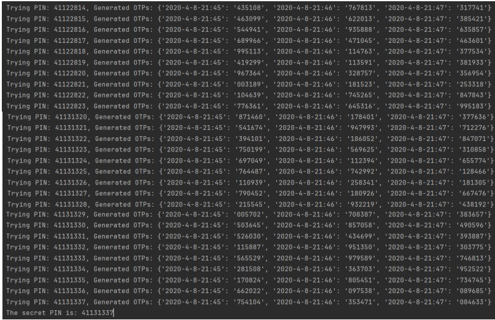
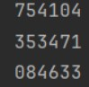

<header >
<h1 style = "text-align: center">REPORT CHALLENGE 3</h1>
<p style ="text-align: center">Titotto Paolo 895227</p>
</header>

## Indice

1. [IDEA RISOLUTIVA](#IDEA RISOLUTIVA)
2. [CODICE RISOLUTIVO](#CODICE RISOLUTIVO)
3. [OUTPUT PROGRAMMA E STAMPA DEI PIN](#OUTPUT PROGRAMMA E STAMPA DEI PIN)
4. [VERIFICA DEGLI OTP](#VERIFICA DEGLI OTP)
##

---
# IDEA RISOLUTIVA
L’idea risolutiva usata per questo challenge è la seguente:
1. È stata creata una funzione generate_otp che prende due parametri: i timestamp e i pin generati. 
    Calcola l’hash del pin e ne genera l’otp prendendo le prime 6 cifre e non 8 come il pin.
```python
def generate_otp(pin, timestamp):
    size = 6
    otp = ''
    h = hashlib.sha256((pin + timestamp).encode()).digest()
    for i in range(size):
        digit = h[i] % 10
        otp += str(digit)
    return otp
```
2. Viene creata una funzione find_pin che prende come parametro un dizionario otp_dict che 
    contiene come chiave i timestamp e come valore gli otp generati.
    Il metodo inizia con un ciclo for con un range di 100000000 che sono tutte le possibili combinazioni 
    di pin generabili da 00000000 a 99999999. La riga successiva converte il pin generato in stringa e
    utilizza la funzione zfill(8) in modo da creare sempre pin della lunghezza corretta aggiungendo 0 
    davanti in caso di necessità.
 ```python
for pin in range(100000000):
    pin_str = str(pin).zfill(8) # Ensure it's 8 digits long
```
``
    La variabile generated_otps crea un dizionario con chiave i timestamp e come valore l’otp generato
    dalla funzione precedente in base al pin e la data associata. Tutto questo viene svolto per ogni 
    chiave del dizionario otp_dict
    
```python
# Generate OTPs for current PIN and put them in a dictionary with the timestap key
generated_otps = {timestamp: generate_otp(pin_str, timestamp) for 
timestamp in otp_dict}
```
`
    Si arriva dunque alla parte conclusiva della funzione, quella dove viene fatto il controllo degli otp.
    Viene fatto l’if su tutti gli otp generati ad uno specifico timestamp presente nel dizionario 
    (richiamato dalla funzione generate_otp[timestamp]) controllando che sia uguale all’otp di 
    otp_dict. In caso affermativo restituisce il pin altrimenti None.
    
    ```python
    if all(generated_otps[timestamp] == otp for timestamp, otp in 
        otp_dict.items()):
         return pin_str
    return None
    ```
    Inoltre si usa la funzione main dove viene creato otp_dict con tutti i rispettivi valori e chiavi.
    Viene invocata la funzione find_pin sul dictionary appena istanziato e attraverso un controllo 
    verifica se il pin è stato trovato ritornandolo oppure stampando il fatto che non è riuscito a 
    scovarlo
    ```python
   ef main():
     otp_dict = {
     '2020-4-8-21:45': '754104',
     '2020-4-8-21:46': '353471',
     '2020-4-8-21:47': '084633'
     }
     print("Trying to find the secret PIN...")
     secret_pin = find_pin(otp_dict)
     if secret_pin:
     print(f'The secret PIN is: {secret_pin}')
     else:
     print('Could not find the secret PIN.')
   ```
# CODICE RISOLUTIVO
Nelle righe che seguono è presente il codice per intero con relativi commenti:
```python
import hashlib
def generate_otp(pin, timestamp):
 size = 6
 otp = ''
 h = hashlib.sha256((pin + timestamp).encode()).digest()
 for i in range(size):
 digit = h[i] % 10
 otp += str(digit)
 return otp

def find_pin(otp_dict):
 for pin in range(100000000):
 pin_str = str(pin).zfill(8) # Ensure it's 8 digits long
 # Generate OTPs for current PIN and put them in a dictionary with the 
timestap key
 generated_otps = {timestamp: generate_otp(pin_str, timestamp) for 
timestamp in otp_dict}
 # Print the current PIN and the generated OTPs
 print(f"Trying PIN: {pin_str}, Generated OTPs: {generated_otps}")
 #check all the opts generated at the specific timestamp with the the otp 
in the dictionary
 if all(generated_otps[timestamp] == otp for timestamp, otp in 
otp_dict.items()):
 return pin_str
 return None
 
def main():
 otp_dict = {
 '2020-4-8-21:45': '754104',
 '2020-4-8-21:46': '353471',
 '2020-4-8-21:47': '084633'
 }
 print("Trying to find the secret PIN...")
 secret_pin = find_pin(otp_dict)
 if secret_pin:
 print(f'The secret PIN is: {secret_pin}')
 else:
 print('Could not find the secret PINN.')
 
if __name__ == "__main__":
 main()
```

# OUTPUT DEL PROGRAMMA E STAMPA DEL PIN
Qui sotto sono presenti alcune stampe dei pin generati e il pin segreto trovato


Le stampe servono per il debug del codice

# VERIFICA DEGLI OTP
Per verificare la correttezza del pin trovato è stata copiata in un altro file la funzione generate_otp e 
istanziato un main che richiama la funzione e come parametri prende il pin e i timestamp relativi forniti 
dalla challenge.

```python
def generate_otp(pin, timestamp):
     size = 6
     otp = ''
     h = hashlib.sha256((pin + timestamp).encode()).digest()
     for i in range(size):
         digit = h[i] % 10
         otp += str(digit)
     return otp
if __name__ == '__main__':
     print(generate_otp('41131337', '2020-4-8-21:45'))
     print(generate_otp('41131337', '2020-4-8-21:46'))
     print(generate_otp('41131337', '2020-4-8-21:47'))
```



